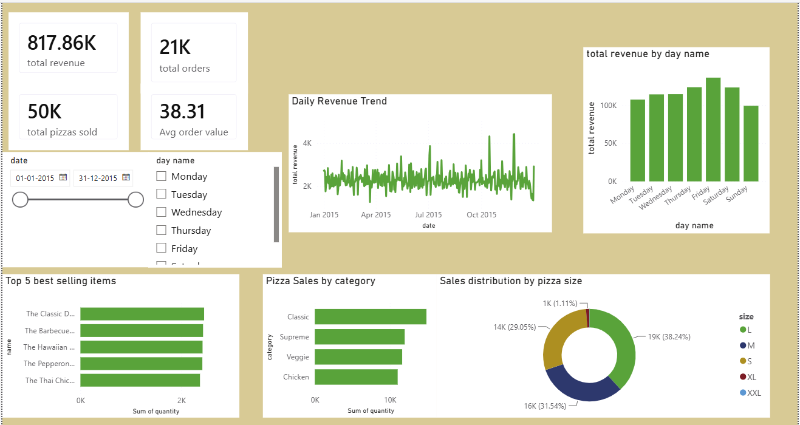

# Pizza Sales Analysis | Power BI

## Overview
An interactive Power BI dashboard designed to analyze pizza sales performance, revenue trends, product popularity, and sales distribution.

## Business Objectives
- Track total revenue, orders, pizzas sold, and average order value.
- Identify the top 5 best-selling pizzas.
- Analyze sales by pizza category and size.
- Explore revenue trends over time and across days of the week.

## Tools & Technologies
- Microsoft Power BI
- Power Query
- DAX
- Data modeling and interactive slicers

## Dashboard Preview

## Key Features
- KPI cards for key sales metrics
- Daily revenue trend analysis
- Top 5 best-selling pizzas
- Category-wise sales analysis
- Pizza-size distribution
- Interactive date and day filters

## Files
- `Pizza_Sales_Analysis.pbix` — Power BI report file
- `dashboard.png` — Dashboard preview

## Author
Shashwat Pandey
